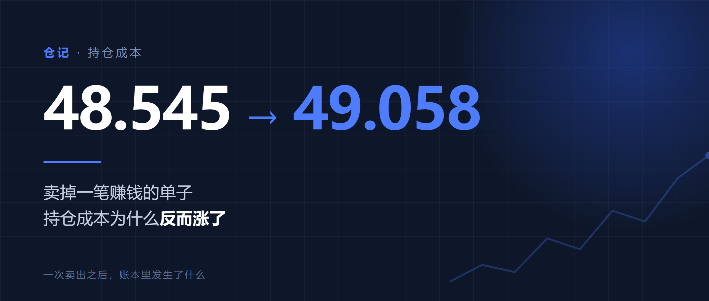
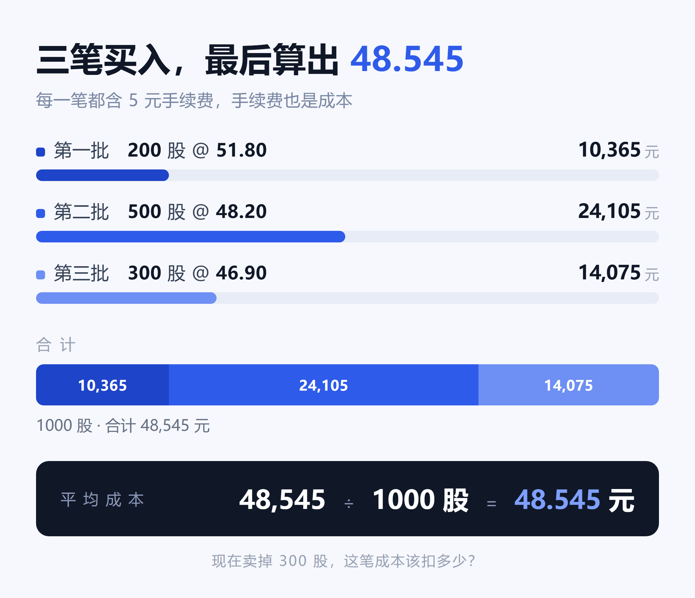
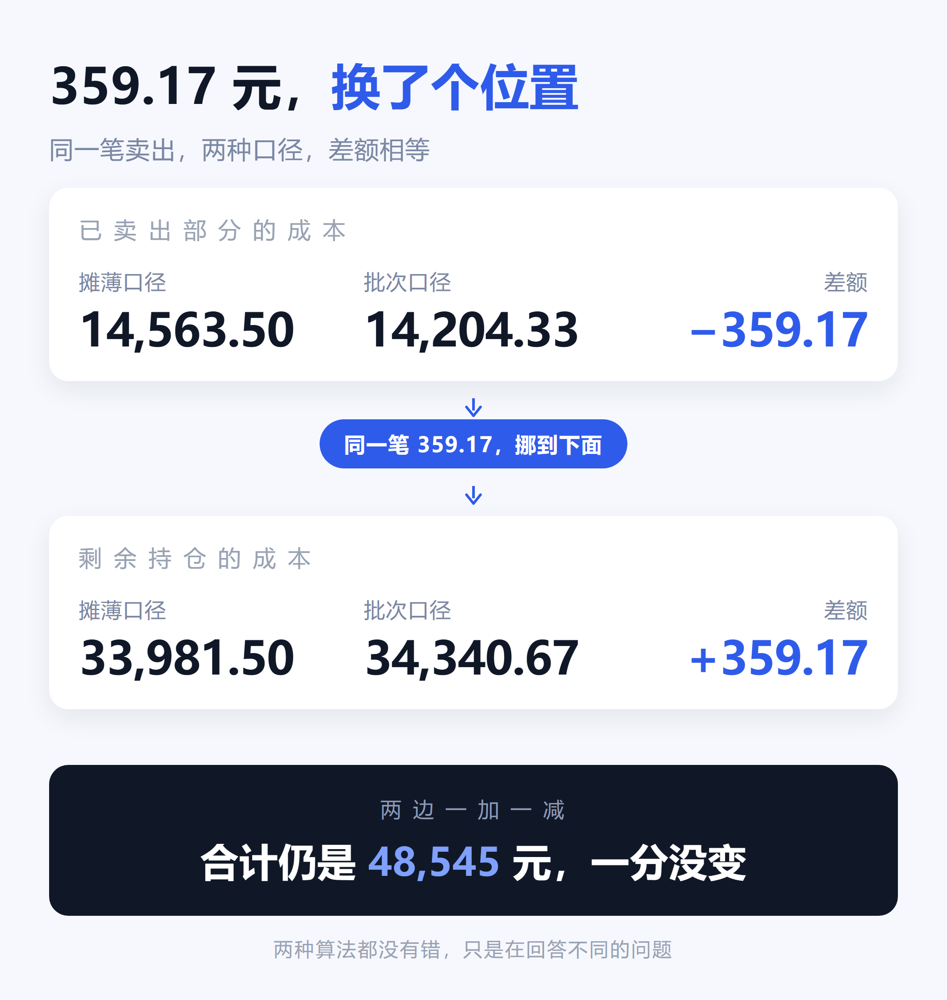

# 卖掉赚钱的那批之后，你的持仓成本为什么会变高

> **摘要（92 字）**：卖掉一笔赚钱的单子，持仓成本反而从 48.545 涨到 49.058。不是软件出错，是成本在「已卖」和「未卖」之间挪了 359 元。本文用一组数字讲清摊薄、批次、先进先出三种口径的区别。
>
> **定位**：产品 / 认知向，不带转化，纯分享
> **篇幅**：正文约 880 字，阅读约 3 分钟
> **发布建议**：21:00–21:30；留言区可置顶一条带数字的自我暴露做示范



---

卖一笔赚钱的单子，持仓成本反而涨了。这不是软件出错。

你持有某只票 1000 股，平均成本 **48.545** 元。某天卖掉 300 股，成交价 52 元，明显是赚的。卖完再看持仓，成本变成了 **49.058** 元。

涨了。下面用一组数字说清楚这件事。

假设你的持仓是这样买进来的：

- 200 股 @51.80，手续费 5 元
- 500 股 @48.20，手续费 5 元
- 300 股 @46.90，手续费 5 元

总共花 48,545 元，1000 股，平均成本 48.545 元。



现在卖掉 300 股，成交价 52 元，手续费 30.6 元，实际到手 15,569.4 元。

这 300 股的成本是多少？两个答案。

**答案一，14,563.5 元。** 总成本除以总股数再乘 300。这笔卖出赚 **1,005.9** 元。

**答案二，14,204.33 元。** 如果这 300 股来自第三批的 200 股（每股成本 46.9167 元）加第二批的 100 股（每股成本 48.21 元）。这笔卖出赚 **1,365.07** 元。

同一笔交易，盈亏差了 **359.17** 元。

关键在这里。

按答案一，剩下 700 股的成本是 33,981.5 元，均价还是 48.545 元。按答案二，剩下 700 股的成本是 34,340.67 元，均价 49.058 元。两边差额同样是 359.17 元。

也就是说：这笔卖出多算了 359 元利润，剩余持仓就多背了 359 元成本。**总数还是那 48,545 元，一分没变，只是在这笔卖出和剩余持仓之间挪了个位置。**



所以两种算法都没错。它们只是在回答两个不同的问题：一个是「我这一整趟操作到现在是什么水平」，一个是「我这一笔单独看赚了多少」。把这两句话混着看，账就永远对不上。

**摊薄成本**，总成本除以剩余股数，判断整体划不划算，券商 App 里的持仓成本基本都是这个。

**批次成本**，每笔买入独立核算，卖出时指定消耗哪一批，判断这一次到底赚没赚。

**先进先出**，默认卖掉最早那批，适合做长线、不想每次指定的人。


做 T 的人，第二种是刚需。因为做 T 的本质就是把同一只票拆成很多次独立的小生意，你赚的是这半天的差价。用摊薄口径去算，这笔差价会被整只票的历史成本稀释掉，最后得出一个既不是今天赚的、也不是总共赚的数字。

我后来把这个算法做成了一个小程序，叫仓记，做的就是第二种口径。

> 但工具是次要的。重要的是你以后再看到「已实现盈亏」这个数字时，会先问一句：它是按哪个口径算的。
>
> 大部分人算不清做 T 的收益，不是数学不好，是从来没人告诉他，账本里其实有三本账。

---

## 配图清单

| 文件 | 尺寸 | 位置 |
| --- | --- | --- |
| `cover-2.35x1.png` | 1175×500 | 首图 / 封面 |
| `fig-1-buys.png` | 1080×930 | 三笔买入列完之后，「两个答案」之前 |
| `fig-2-cost-shift.png` | 1080×1140 | 「359 元挪了个位置」那段之后 |
| `fig-3-methods.png` | 1080×960 | 三种口径三段之后 |
| `cover-square.png` | 1080×1080 | 转发缩略图（不上正文） |

`fig-2-cost-shift.png` 是全文的认知支点，最不能砍。

## 改动须知

所有图都不是 AI 生成的，而是 HTML/CSS 排版后用无头浏览器截图，源稿在同目录 `src/` 下。改文案、换主色、调字号，改 `src/*.html` 后重新渲染即可：

```bash
chrome --headless=new --hide-scrollbars --force-device-scale-factor=2 \
  --window-size=1175,500 --screenshot=cover-2.35x1.png src/cover.html
```

正文图一律按 **1080px 宽**设计——公众号正片图在手机上只渲染约 400px 宽，按 1920px 设计会把正文字号缩到看不清。

## 合规自查

- 无个股推荐、无收益承诺、无诱导关注
- 涉及券商产品的表述统一用「大部分」「基本都是」这类中性口径，不对具体机构做评价
