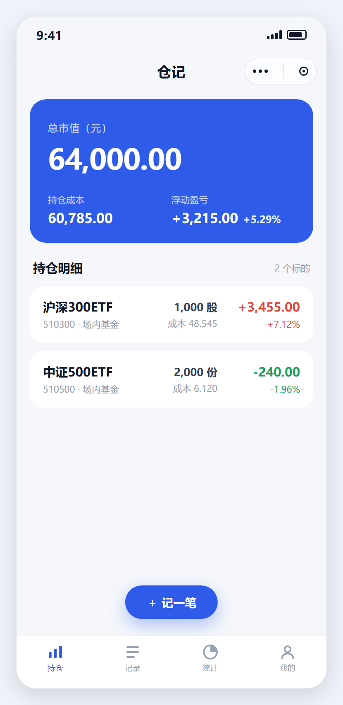
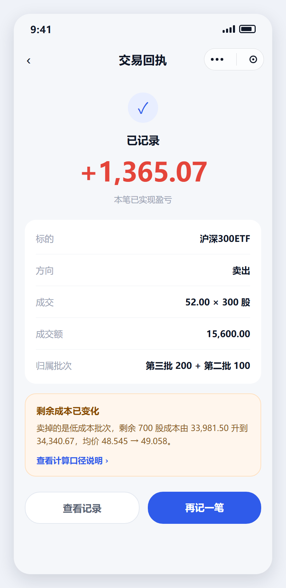
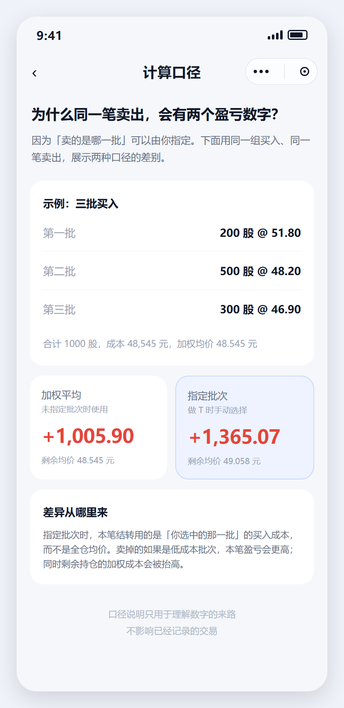

# 我用 AI 一个小时做完了小程序，但重点不是那一个小时

> **摘要（104 字）**：让 AI 一小时写完一个小程序，是能办到的。但那一小时里，它只干了四十分钟的活，另十分钟在改自己的错；而真正的成本，在动手之前那些把决定说死的文档里。
>
> **定位**：技术 / 产品双线，面向独立开发者与产品经理
> **篇幅**：正文约 1000 字，阅读约 3 分半
> **口径说明**：文中「一小时」严格指**代码落地阶段**，不含需求、方案、UI 与验收标准的准备时间。这一点必须保留，否则会被读成夸大宣传。
> **发布建议**：工作日 12:30–13:00 或 21:00–21:30


---

先说结论：能做完。但不是你以为的那种做完。

我让 AI 从零写了一个记录基金股票交易的小程序，跑通了类型检查和 59 个测试，核心的重放引擎在 3000 笔交易下耗时 7 毫秒。



但值得说的不是「一小时」，是那一小时里发生了什么。

## 一、那一个小时是这么用的

前十分钟，我准备材料：需求文档、技术方案、UI 稿，还有一份专门写给 AI 看的执行手册。手册里规定了目录结构、数据类型、单位约定、公式、错误码，以及一条不许改的规则：金额一律用整数「分」，价格用「厘」，数量用「千分之一股」。

中间四十分钟，它按手册写模块：金额换算、成本结转、批次分摊、重放引擎、服务层、组件、九个页面。每写完一个，就运行一次测试。



最后十分钟，修改它自己写错的地方。

真正在写代码的只有中间那四十分钟。而前面准备的那些材料，是之前好几天才想清楚的。

## 二、一小时能成立，是因为有个东西先被固定下来

我管它叫契约。

在让 AI 写第一行代码之前，先把这些固定下来：目录怎么分、类型长什么样、金额用什么单位、盈亏用哪个公式、哪些错误码必须存在、哪个模块不许依赖哪个模块。

为什么？因为 AI 不会替你做这些决定，但它会做得很随意。你让它写「卖出结转成本」，它会自己挑一种算法；下次改另一个模块，它可能挑了另一种。两个模块各自都对，合起来对不上。

**这类错误最难查，因为没有任何一处代码是错的。**



## 三、AI 真正帮我的，是把决定变成代码

我原以为它最大的价值是「写得快」。用下来发现不是。

写得快只是表象。它真正的价值是：一旦决定说清楚到没有歧义，它能在十分钟内把这个决定铺满整个项目，而且不出偏差。

前提是「说清楚到没有歧义」。这件事它帮不了你。

## 四、两次它明显不行

第一次是性能。初版重放 3000 笔要 50 毫秒，目标 10 毫秒以内。我把数字告诉它，它给出了三个方向：加缓存、优化排序、减少循环。

全错。

我自己分段计时去测，才发现瓶颈在一个没想到的地方：加权卖出时每笔都会生成一个批次归属数组，而这个数组后面根本没人用。它纯粹是多余的。

改掉这一行，**50 毫秒直接掉到 7 毫秒**。它猜的三个方向一个都没用上。

AI 能读懂代码，但它不会怀疑「这段代码为什么要存在」。性能问题十次有八次就藏在这里面。

第二次是被测试抓出来的。我写了一条不变量：卖出成本加持仓成本，任何时刻必须等于总成本，一分不差。

随机跑了几百组后，有一组没通过：某个批次数量已经扣到 0，成本还剩 4 分钱挂在那儿。

AI 改了两次都不对。第一版把超出部分截断，成本守恒了，但剩余均价从 48.545 变成 48.550；第二版按剩余数量重新分摊，均价对了，成本又对不上。

最后正确的解法是：每批按自己的单位成本比例扣，零头只补给还有剩余数量的批次，且不超过它们各自的剩余成本。

> AI 每次都能写出一个「看起来合理」的版本。哪一版真的对，只能靠那条不变量去判断。所以那条测试比它写的所有代码都重要。

## 五、所以「一小时」到底成不成立

成立，但得把话说完整。

一小时能完成的，是把已经想清楚的东西变成可运行的代码。

一小时不能完成的，是想清楚。

我那一个小时之前还做了这些：写需求文档、把口径改成两种算法可对照的样子、把技术方案里五个关键决策敲定、把三组金标准数字先手算出来当验收标准。

尤其是最后一件：**我先把正确答案算出来了，才让它写代码。**

反过来，先让它写、再让它自己解释对不对，它会给你一套自洽的解释——自洽，但不一定对。

用 AI 写东西这段时间，我最大的变化不是变快了，是容错变差了。

以前写错一个算法要三小时才 debug 出来，所以动手前会多想一会儿。现在写错十分钟就改完，于是开始懒得想。

一小时做完一个小程序是真的。但那个一小时里省掉的，恰好是最值钱的那一段。

---

## 配图清单

| 文件 | 尺寸 | 位置 |
| --- | --- | --- |
| `cover-2.35x1.png` | 1175×500 | 首图 / 封面 |
| `shot-01-position.png` | 830×1704 | 引言「7 毫秒」之后 |
| `shot-02-receipt.png` | 830×1704 | 第一节「九个页面」之后 |
| `shot-03-guide.png` | 830×1704 | 第二节契约清单之后 |
| `overview-3up.png` | 1080×940 | 三屏总览（备用，正文不放） |
| `cover-square.png` | 1080×1080 | 转发缩略图（不上正文） |

单屏截图按 415×852 设计、2 倍渲染，公众号缩到约 400px 宽时正文约 14px，可读。三屏拼图在同样宽度下每屏仅约 130px，字会糊，所以只作备用。

## 改动须知

截图不是真机截的，是按小程序真实页面结构、真实设计变量（`styles/tokens.wxss`）与金标准数值重新渲染的，源稿在 `src/` 下。改文案后重新渲染：

```bash
chrome --headless=new --hide-scrollbars --force-device-scale-factor=2 \
  --window-size=415,852 --screenshot=shot-01-position.png src/shot-01-position.html
```

## 合规自查

- 无收益承诺、无产品推销
- 「一小时」已限定为代码落地阶段，避免被理解为「AI 一小时做完整个产品」
